# Encuentro AAA · Proyecto Integrado IV

## El Observatorio en Docker: el proceso completo de integración, desde una app

> **Curso:** Proyecto Integrado IV – Integración de Información · IU Digital de Antioquia · 2026-2
> **Docente:** Carlos Arturo Castro Castro
> **Repositorio:** https://github.com/ccastro2050/observatorio-energia-docker

### ¿De qué trata esta guía?

> ⭐ **Es un plus, un ejemplo opcional.** No es un requisito de la entrega final: sirve para **ver el proceso completo funcionando** y como modelo para su proyecto. Se usa **casi sin comandos**: se prende una vez y luego todo es con clics, incluida la carga de archivos.

Hasta ahora construimos el Observatorio **por partes**: extracción, calidad, dbt y dashboard, cada una con sus comandos. Esta guía muestra **el proceso completo funcionando en un solo aplicativo**, para **verlo de punta a punta** antes de terminar la entrega final.

- Se prende con **un solo comando** (Docker).
- Después, **todo se hace con clics**: traer los datos, limpiarlos, armar el modelo con dbt y ver el dashboard.
- El dashboard **se actualiza solo** cada vez que se corre el proceso.

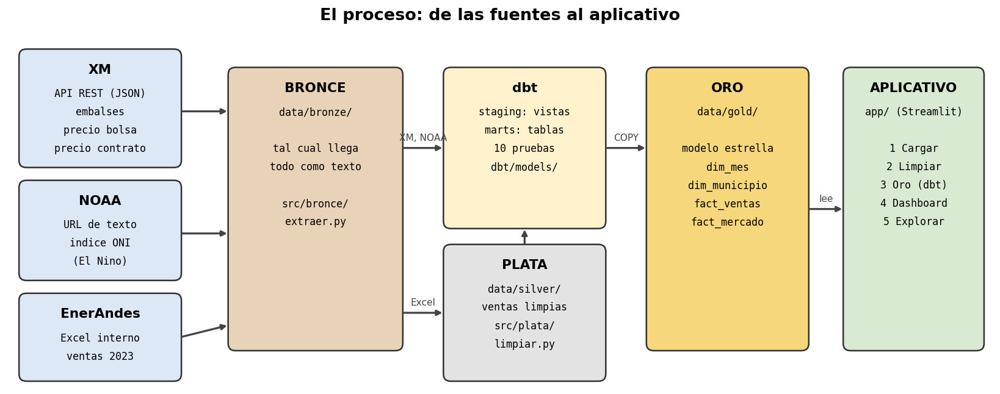

| Término | Qué significa |
|---|---|
| **Capa bronce** | Los datos **tal cual llegan** de cada fuente, sin corregir nada |
| **Capa plata** | Los datos **limpios**, corregidos con reglas |
| **Capa oro** | El **modelo estrella**, armado y **probado** con dbt: lo que lee el dashboard |
| **Docker** | Empaca el proyecto con todo lo que necesita (Python, dbt, Streamlit) para que corra **igual en cualquier PC** |
| **Contenedor** | El proyecto empacado, **corriendo** |
| **Aplicativo** | La página web (hecha con Streamlit) desde donde se maneja todo |

### Las 3 preguntas de negocio de este ejemplo

| # | Pregunta | Fuentes |
|---|---|---|
| 1 | ¿Cómo estuvieron los **embalses** y el precio mes a mes en 2023? | XM |
| 2 | ¿**El Niño** sube el precio de la energía? ¿Cuánto? | NOAA + XM |
| 3 | ¿Cuánto habría costado comprar **en bolsa** lo que se compró por contrato? ¿Dónde está el riesgo? | EnerAndes + XM |

> 📌 Es una versión **reducida a propósito** del proyecto de clase: 2023, 3 métricas de XM, 3 preguntas. Así el proceso completo corre en **menos de un minuto**.

---

## Parte 0 · Preparar el computador

**¿Para qué?** Tener las 3 herramientas. Se instalan **una sola vez**.

| Herramienta | Para qué | Cómo comprobar que está |
|---|---|---|
| **Git** | Bajar el proyecto de GitHub | `git --version` |
| **Docker Desktop** | Correr el proyecto (Python, dbt y Streamlit van **dentro**) | `docker --version` |
| **VS Code** | Ver el código y usar la terminal | Abrirlo |

> ⚠️ **Docker Desktop debe estar abierto** antes de seguir: en la barra de tareas aparece la ballena 🐳, y en Docker Desktop, abajo a la izquierda, dice **Engine running**.

> 💡 **No hace falta instalar Python, dbt ni Streamlit.** Todo eso viene dentro del contenedor.

---

## Parte 1 · Bajar y prender el proyecto (los únicos comandos)

En VS Code: **Terminal → New Terminal**. Peguen, uno por uno:

```powershell
cd C:\                                                                   # pararse en C:\ (o la carpeta que prefieran)
git clone https://github.com/ccastro2050/observatorio-energia-docker.git  # bajar el proyecto
cd observatorio-energia-docker                                           # entrar a la carpeta
docker compose up --build -d                                             # construir y prender todo
```

| Comando | Qué hace |
|---|---|
| `git clone ...` | Baja el proyecto de GitHub a la carpeta `observatorio-energia-docker` |
| `docker compose up` | Prende los contenedores que dice `docker-compose.yml` |
| `--build` | Construye primero la **imagen**: instala Python, dbt y Streamlit **dentro**. La primera vez tarda de 3 a 5 minutos |
| `-d` | En segundo plano: devuelve la terminal |

**Qué se prende:**

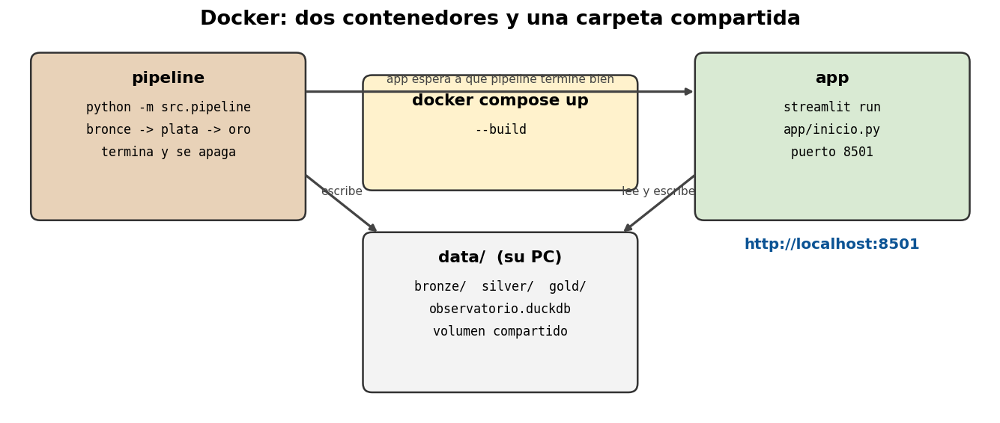

| Contenedor | Qué hace |
|---|---|
| `pipeline` | Corre el proceso una vez (bronce → plata → oro), termina y se apaga |
| `app` | El aplicativo. Se queda prendido en el puerto **8501** |

Abran en el navegador: **http://localhost:8501**

> ✅ **Desde aquí no hay que escribir más comandos.** Todo se hace en el aplicativo.

---

## Parte 2 · El Panel de control

Es la página que se abre al entrar. Desde aquí se maneja **todo el proceso**.

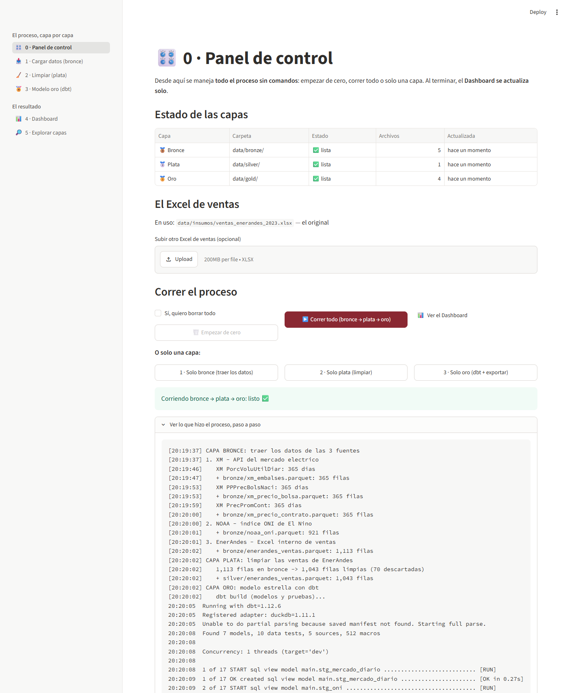

| Lo que aparece | Qué significa |
|---|---|
| **Menú de la izquierda** | Las 6 páginas: el panel, las 3 capas y el resultado |
| **Estado de las capas** | Bronce, plata y oro: ✅ lista o ❌ vacía, cuántos archivos tiene y hace cuánto se actualizó |
| **El Excel de ventas · En uso** | Cuál Excel está usando el proceso: el original o uno que ustedes subieron |
| **Subir otro Excel de ventas** | Para usar su propio archivo (Parte 4) |
| **🗑️ Empezar de cero** | Borra las 3 capas, como si el proyecto estuviera recién bajado. Se activa al marcar *Sí, quiero borrar todo* |
| **▶️ Correr todo** | Corre las 3 capas en orden |
| **O solo una capa** | Correr solo bronce, solo plata o solo oro |
| Recuadro verde **listo ✅** | El proceso terminó bien |
| **Ver lo que hizo el proceso, paso a paso** | Lo que escribió cada capa: cuántas filas trajo, cuántas limpió, las pruebas de dbt |

### Paso 2.1 · Empezar de cero

1. Marquen **Sí, quiero borrar todo**.
2. Clic en **🗑️ Empezar de cero**.

En **Estado de las capas**, las tres quedan en **❌ vacía**. Si abren **4 · Dashboard**, dice *"Todavía no hay capa oro"*: no hay datos que mostrar.

### Paso 2.2 · Correr todo

Clic en **▶️ Correr todo (bronce → plata → oro)**. Tarda de 20 segundos a 1 minuto.

Al terminar, las tres capas quedan en **✅ lista** y abajo aparece lo que hizo el proceso:

| Lo que aparece | Qué significa |
|---|---|
| `CAPA BRONCE: traer los datos de las 3 fuentes` | Empieza la capa bronce |
| `XM PorcVoluUtilDiar: 365 dias` | Bajó un año de embalses de la API de XM, en pedazos de 30 días |
| `+ bronze/noaa_oni.parquet: 921 filas` | Bajó el índice de El Niño de NOAA |
| `+ bronze/enerandes_ventas.parquet: 1,113 filas` | Leyó el Excel de ventas, **tal cual** |
| `1,113 filas en bronce -> 1,043 filas limpias (70 descartadas)` | La capa plata corrigió lo que pudo y descartó 70 filas malas |
| `Done. PASS=17 WARN=0 ERROR=0` | dbt creó 7 modelos y pasaron las **10 pruebas** de calidad |
| `+ gold/fact_ventas.parquet: 1,043 filas` | El modelo estrella quedó en la capa oro |

> 💡 Si sale `! XM no respondio (...). Se usa el respaldo.`, no es un error: no había internet o XM estaba caído, y el proceso usó la **copia de respaldo** que trae el proyecto.

### Paso 2.3 · Ver el dashboard

Clic en **📊 Ver el Dashboard**. Ya tiene los datos nuevos: **se actualizó solo**.

---

## Parte 3 · El dashboard

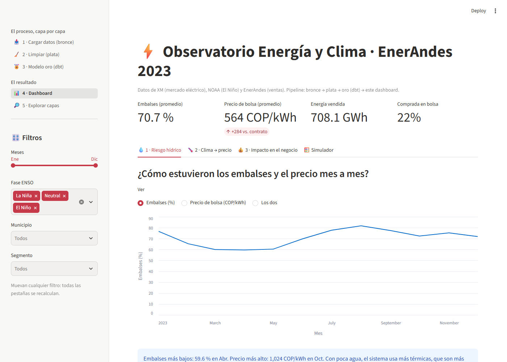

| Lo que aparece | Qué significa |
|---|---|
| **Filtros** (izquierda) | Meses, fase de El Niño, municipio y segmento. **Al moverlos, todo se recalcula** |
| **Embalses (promedio)** | KPI: qué tan llenos estuvieron los embalses |
| **Precio de bolsa** y su delta rojo **+284 vs. contrato** | KPI: cuánto costó la energía en bolsa, y cuánto **más** que por contrato |
| **Energía vendida** | KPI: toda la energía que vendió EnerAndes |
| **Comprada en bolsa** | KPI: qué parte compró en bolsa (la más riesgosa) |
| Las 4 pestañas | Una por pregunta, más el **Simulador** |
| Recuadro azul | La **conclusión**, con números **calculados** por el código |

### Pestaña 1 · Riesgo hídrico

Arriba, **Ver** deja elegir qué graficar: embalses, precio o **los dos**. Al elegir **Los dos** se ve que, cuando bajan los embalses, sube el precio.

### Pestaña 2 · Clima → precio

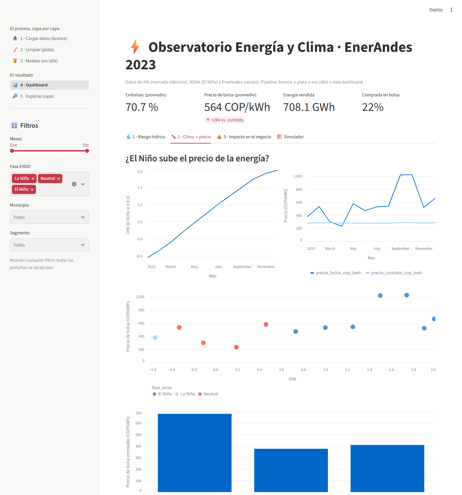

| Gráfico | Qué muestra |
|---|---|
| ONI (izquierda) | El Niño empieza en junio de 2023 (ONI ≥ 0,5) y crece hasta diciembre |
| Precios (derecha) | La bolsa (oscura) se dispara en septiembre y octubre; el contrato (clara) casi no se mueve |
| Puntos | Cada punto es un mes, con color según la fase: los de El Niño están más arriba |
| Barras | El precio promedio en cada fase |

**Interpretación:** en los meses de El Niño la bolsa costó en promedio **680 COP/kWh**, frente a **409** en los neutrales: **1,7 veces más**. El precio de contrato casi no cambia: **el contrato protege**.

### Pestaña 3 · Impacto en el negocio

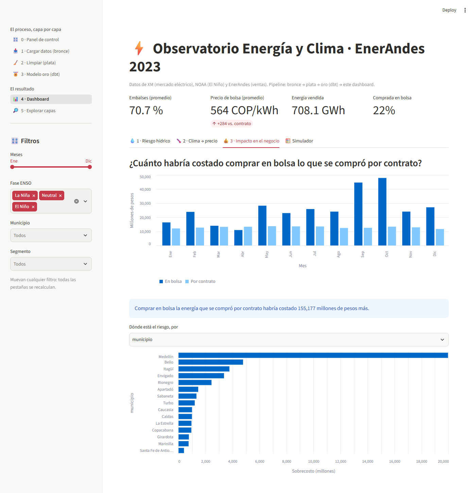

| Lo que aparece | Qué significa |
|---|---|
| Barras por mes | Lo que **costó** por contrato (clara) y lo que **habría costado** en bolsa (oscura) |
| Recuadro azul | Comprar en bolsa lo que se compró por contrato habría costado **155.177 millones más** |
| **Dónde está el riesgo, por** | Elegir **municipio** o **segmento** |
| Barras horizontales | Lo que costó de más la energía que **sí** se compró en bolsa. **Medellín** concentra el mayor riesgo |

### Pestaña 4 · Simulador

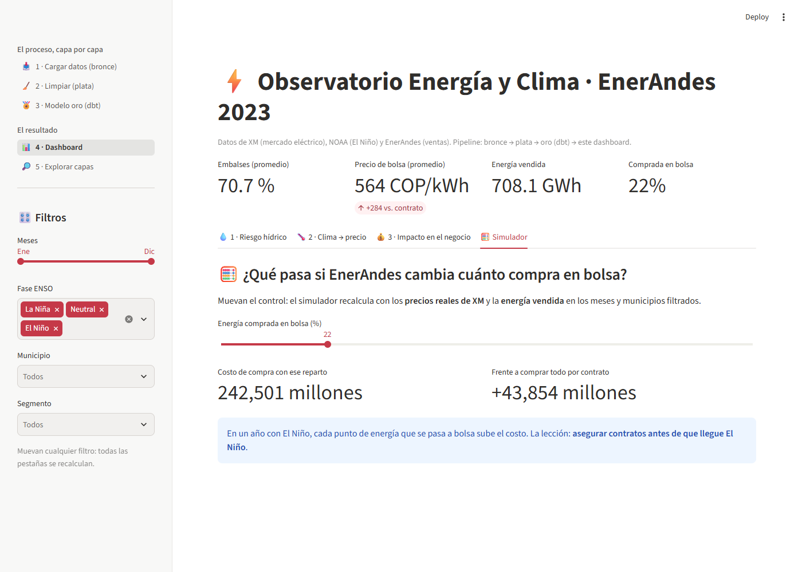

Muevan el control **Energía comprada en bolsa (%)**:

| Si compran en bolsa | El costo frente a todo por contrato |
|---|---|
| 22 % (lo que hizo EnerAndes) | Unos **44.000 millones más** |
| 60 % | Unos **120.000 millones más** |
| 0 % | Lo mismo que todo por contrato |

**La lección para la gerencia:** asegurar contratos **antes** de que llegue El Niño.

### Ejercicio 1 · Los filtros

1. En **Fase ENSO**, quiten **La Niña** y **Neutral**: queden solo los meses de **El Niño**.
2. Miren cómo cambian los 4 KPIs y las conclusiones.
3. En **Municipio**, elijan **Medellín**. ¿Cuánto pesa Medellín en el sobrecosto?

---

## Parte 4 · Subir su propio Excel

El proceso puede usar **otro Excel de ventas**, sin tocar el código.

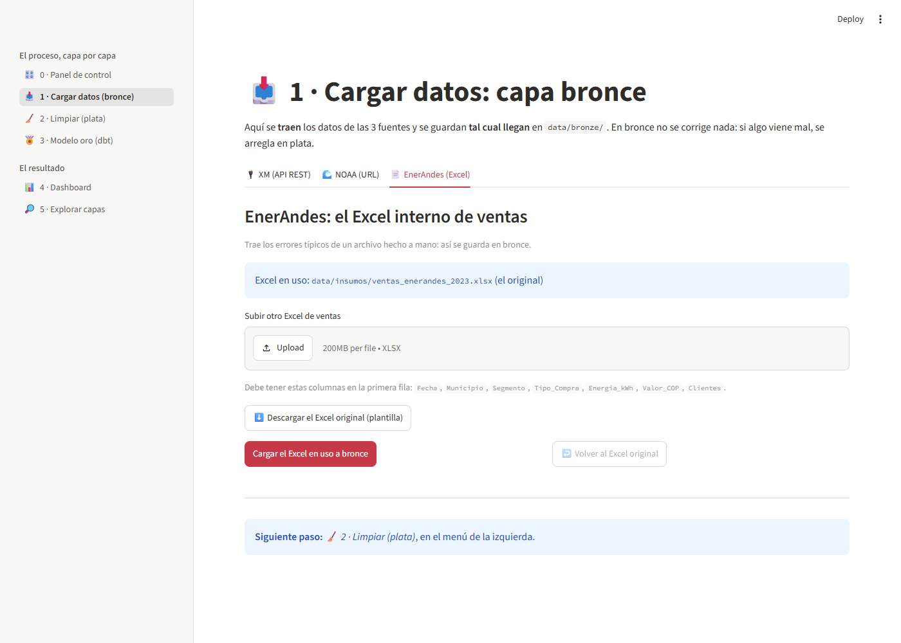

| Botón | Qué hace |
|---|---|
| **⬇️ Descargar el Excel original (plantilla)** | Baja el Excel que trae el proyecto, para usarlo de modelo |
| **Subir otro Excel de ventas** (Browse files) | Sube su archivo. Si le faltan columnas, dice **cuáles** |
| **Cargar el Excel en uso a bronce** | Lo pasa a la capa bronce, tal cual |
| **↩️ Volver al Excel original** | Deja de usar el suyo |

> ⚠️ El Excel debe tener estas columnas en la primera fila: `Fecha`, `Municipio`, `Segmento`, `Tipo_Compra`, `Energia_kWh`, `Valor_COP`, `Clientes`.

### Ejercicio 2 · Cambiar los datos y ver el dashboard actualizarse

1. **Descarguen la plantilla** y ábranla en Excel.
2. Cambien algo que se note: por ejemplo, multipliquen por 10 la `Energia_kWh` de las filas de **Bello**. Guarden.
3. En el **Panel de control**, **suban** ese Excel. Debe decir *✅ Excel guardado*.
4. Clic en **▶️ Correr todo**.
5. Abran el **Dashboard**, pestaña **Impacto en el negocio**, **por municipio**: Bello debe subir.
6. Al terminar: **↩️ Volver al Excel original** y **▶️ Correr todo**.

---

## Parte 5 · Las capas, una por una

Las páginas 1, 2 y 3 hacen lo mismo que **Correr todo**, pero **capa por capa**, mostrando qué pasa en cada una.

| Página | Qué se puede hacer | Qué se ve |
|---|---|---|
| **📥 1 · Cargar datos** (bronce) | Elegir **métricas** y **fechas** de XM, cambiar la **URL** de NOAA, subir el Excel. Botones de **respaldo** sin internet | Las primeras filas de cada archivo, **tal cual** llegaron |
| **🧹 2 · Limpiar** (plata) | Ver las **7 reglas** y aplicarlas | El **antes y después**: `MEDELLIN`, `Medellín D.E.` y `medellin` se vuelven **un solo** Medellín |
| **🏅 3 · Modelo oro** (dbt) | Ejecutar **dbt build** | El modelo estrella, `PASS=17` y las 4 tablas exportadas |
| **🔎 5 · Explorar capas** | Elegir una capa y un archivo, y **buscar** dentro | El mismo dato en bronce (texto), plata (limpio) y oro (modelo) |

### La página 1, pestaña XM: traer los datos de la API

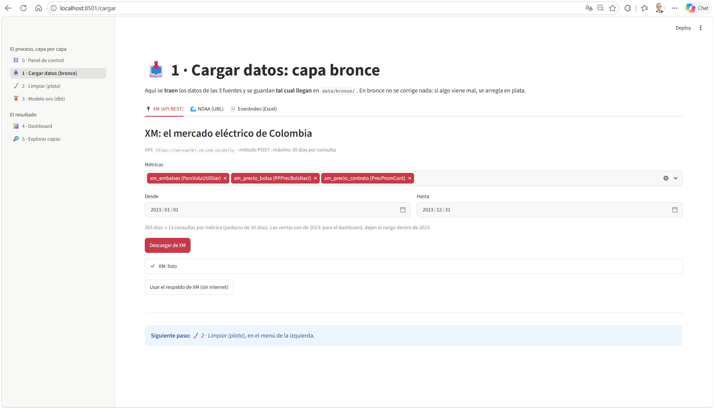

| Lo que aparece | Qué significa |
|---|---|
| `API: https://servapibi.xm.com.co/daily · método POST · máximo 30 días por consulta` | La dirección de la API de XM y su límite: por eso el código pide el año en **pedazos de 30 días** |
| **Métricas**: `xm_embalses (PorcVoluUtilDiar)`, `xm_precio_bolsa (PPPrecBolsNaci)`, `xm_precio_contrato (PrecPromCont)` | Qué se le pide a XM. Primero el **nombre del archivo** en bronce y, entre paréntesis, el **código de la métrica** en XM |
| **Desde / Hasta** | El rango de fechas. Debajo dice cuántas consultas hará: 365 días → 13 por métrica |
| **Descargar de XM** | Pide los datos y los guarda en `data/bronze/`, tal cual llegan |
| **XM: listo** ✓ | Terminó. Con un clic en el recuadro se ven los archivos guardados y sus filas |
| **Usar el respaldo de XM (sin internet)** | Si XM no responde, copia los datos de `data/ejemplo/` |

**¿Se pueden quitar o poner métricas?** Sí, pero **solo entre esas 3**: se quitan con la **✕** y se vuelven a poner desde la flecha **⌄**. Si se quita una y luego se corre la capa oro, la página 3 avisa *"Faltan archivos: xm_..."*, porque **dbt necesita las 3** para armar el modelo. Así se ve que **cada capa depende de la anterior**.

**¿Y cómo se agrega una métrica NUEVA?** No desde la app: en el **código**, recorriendo **toda la cadena**. Por ejemplo, la demanda de energía:

| # | Archivo | Qué se agrega | Ejemplo: la demanda |
|---|---|---|---|
| 1 | `src/config.py` → `XM_METRICAS` | Una línea con el código de XM y el nombre del archivo | `("DemaReal", "Sistema", "xm_demanda"),` |
| 2 | El aplicativo, página 1 | **Nada**: la métrica aparece sola en la lista y se guarda en bronce | `bronze/xm_demanda.parquet` |
| 3 | `dbt/models/staging/sources.yml` | Declarar el archivo nuevo | `- name: xm_demanda` |
| 4 | `dbt/models/staging/stg_mercado_diario.sql` | Pasarla a número y unirla por fecha | `try_cast(d."Value" as double) as demanda_kwh` |
| 5 | `dbt/models/marts/fact_mercado.sql` | El total o el promedio del mes | `sum(demanda_kwh) as demanda_kwh` |
| 6 | `app/paginas/dashboard.py` | Un gráfico o una pestaña nueva | `st.line_chart(m, x="mes", y="demanda_kwh")` |

> 💡 **Por qué así:** cada capa tiene que saber qué hacer con el dato nuevo. La app solo pone **botones encima** del proceso: el proceso se define en el código. Es lo mismo que hace cada equipo en la entrega final con **sus** métricas. Los códigos de XM están en el catálogo: https://github.com/EquipoAnaliticaXM/API_XM

### La página 1, pestaña NOAA: un archivo de texto en internet

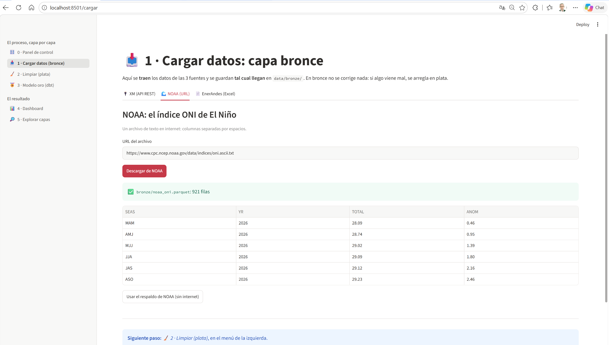

| Lo que aparece | Qué significa |
|---|---|
| **URL del archivo** | La dirección del archivo de NOAA. **Se puede cambiar** por otra, sin tocar el código |
| **Descargar de NOAA** | Baja el archivo y lo guarda en `data/bronze/noaa_oni.parquet`, tal cual |
| ✅ `bronze/noaa_oni.parquet: 921 filas` | Una fila por **trimestre**, desde 1950 |
| `SEAS` | El trimestre móvil: `JAS` = julio-agosto-septiembre |
| `YR` | El año |
| `TOTAL` | La temperatura del mar en el Pacífico (°C) |
| `ANOM` | La **anomalía**: cuánto más caliente que lo normal. **+0,5 o más = El Niño**. En 2026 llega a **+2,46**: un Niño fuerte |

> 📌 Aquí **todo sigue siendo texto** (`'2.46'`, no el número 2,46): es la capa bronce. dbt lo convierte a número y le pone la fase (*El Niño*, *Neutral*, *La Niña*) en la capa oro.

### La página 1, pestaña EnerAndes: el Excel, con sus errores

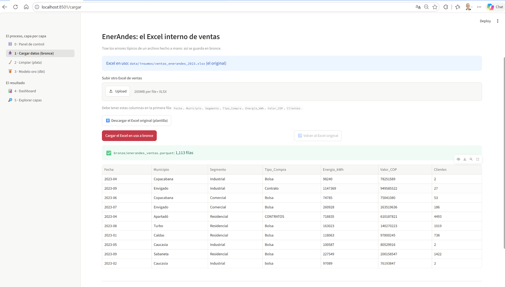

| Lo que aparece | Qué significa |
|---|---|
| **Excel en uso** | Cuál Excel se carga: el original o uno que ustedes subieron |
| ✅ `bronze/enerandes_ventas.parquet: 1,113 filas` | El Excel quedó en bronce **completo**, con todas sus filas |
| `CONTRATOS`, `Contrato`, `bolsa`, `Bolsa` | El **mismo** tipo de compra escrito de varias formas. En bronce **no se corrige**: lo arregla la capa plata |

### ¿Dónde quedan los archivos? En su PC **y** en Docker

Es **la misma carpeta**, compartida. Lo hace esta línea de `docker-compose.yml`:

```yaml
volumes:
  - ./data:/app/data      # la carpeta data/ del PC = la carpeta /app/data del contenedor
```

| Dónde | Ruta |
|---|---|
| En su PC | `observatorio-energia-docker\data\bronze\` (ábranla en VS Code) |
| Dentro del contenedor | `/app/data/bronze/` |

Se llama **volumen**: lo que el contenedor escribe, ustedes lo ven en el PC, y al revés. Por eso, al apagar Docker (`docker compose down`), **los datos no se pierden**.

### La página 2: limpiar

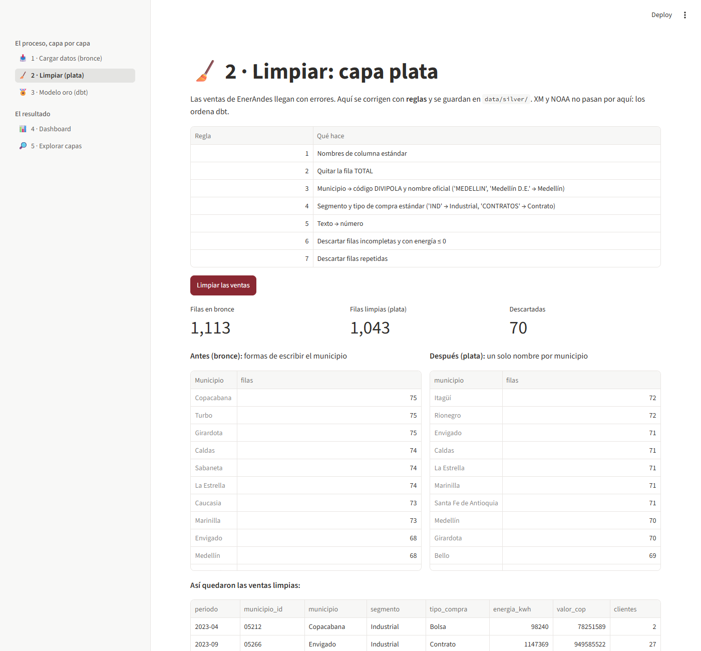

| Lo que aparece | Qué significa |
|---|---|
| **Filas en bronce 1.113 · Filas limpias 1.043 · Descartadas 70** | Las 70 son la fila `TOTAL`, las incompletas, las de energía negativa y las repetidas |
| **Antes (bronce)** | Las formas de escribir el municipio. **Bajen dentro de esa tabla**: al final aparecen `MEDELLIN`, `Medellín D.E.`, `Rio Negro`... con pocas filas cada una |
| **Después (plata)** | **Un solo nombre** por municipio: las variantes se sumaron a su municipio correcto |
| **Así quedaron las ventas limpias** | Columna nueva `municipio_id` (el código DIVIPOLA: `05212` = Copacabana); `CONTRATOS` y `bolsa` ahora son `Contrato` y `Bolsa`; los números ya son **números** (alineados a la derecha) |

### La página 3: el modelo oro con dbt

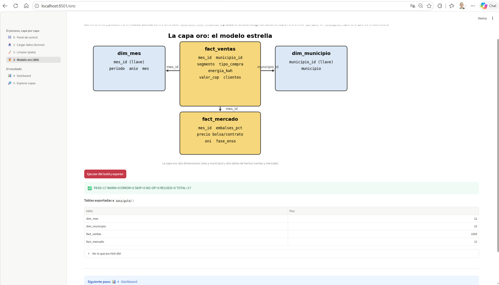

| Lo que aparece | Qué significa |
|---|---|
| La imagen del **modelo estrella** | Lo que dbt construye: 2 **dimensiones** (azules) y 2 tablas de **hechos** (amarillas), unidas por sus **llaves** (`mes_id`, `municipio_id`) |
| **Ejecutar dbt build y exportar** | Corre `dbt build` (crear los modelos y probarlos) y copia las tablas a `data/gold/` |
| ✅ `PASS=17 WARN=0 ERROR=0` | **7 modelos** creados y **10 pruebas** de calidad pasadas. Si una prueba falla, sale en rojo y **no se exporta nada** |
| **Tablas exportadas a `data/gold/`** | `dim_mes` 12 meses · `dim_municipio` 15 municipios · `fact_ventas` 1.043 ventas · `fact_mercado` 12 meses |
| **Ver lo que escribió dbt** | El detalle: cada modelo y cada prueba, uno por uno |

### Ejercicio 3 · El mismo dato en las tres capas

En **🔎 5 · Explorar capas**, escriban `Medellín` en el buscador y cambien de capa:

| Capa | Qué deben encontrar |
|---|---|
| Bronce, `enerandes_ventas` | Medellín escrito de **varias formas**, y **todo es texto** (miren *Ver los tipos de cada columna*) |
| Plata, `enerandes_ventas` | **Un solo** Medellín, con su código `05001`, y los números ya son números |
| Oro, `dim_municipio` | **Una fila**: `05001 · Medellín` |

---

## Parte 6 · Apagarlo

Cuando terminen, en la terminal de VS Code, dentro de la carpeta del proyecto:

```powershell
docker compose down                     # apaga y quita los contenedores; los datos de data/ se quedan
```

Para prenderlo otro día: `docker compose up -d` (ya sin `--build`, porque la imagen ya está construida).

---

## Si algo falla

| Si sale | Por qué | Qué hacer |
|---|---|---|
| `Cannot connect to the Docker daemon` o `docker: command not found` | Docker Desktop está cerrado o no está instalado | Abrir Docker Desktop y esperar a que diga **Engine running** |
| `port is already allocated` (8501) | Otro programa usa el puerto 8501 | `docker ps` para ver cuál y apagarlo; o en `docker-compose.yml` cambiar `"8501:8501"` por `"8502:8501"` y abrir `localhost:8502` |
| `localhost rechazó la conexión` | Los contenedores no están prendidos | `docker compose up -d` |
| El dashboard dice *"Todavía no hay capa oro"* | No se ha corrido el proceso, o se empezó de cero | Panel de control → **▶️ Correr todo** |
| `Correr todo: falló ❌` | Falló una capa (por ejemplo, una prueba de dbt) | Abrir **Ver lo que hizo el proceso** y leer el error |
| *No se pudo usar ese Excel: le faltan estas columnas* | El Excel no tiene los nombres de columna esperados | Descargar la **plantilla** y copiar sus datos ahí |

---

## De este ejemplo a su entrega final

| Aquí | En su proyecto |
|---|---|
| 3 fuentes: XM, NOAA y un Excel | Sus fuentes |
| Las reglas de `src/plata/limpiar.py` | Las reglas que necesiten **sus** datos |
| 4 tablas en `dbt/models/marts/` | Su modelo estrella, con sus pruebas |
| 3 preguntas en el dashboard | Sus preguntas de negocio, cada una con su conclusión |

> 📚 Cada concepto está explicado en el repositorio, en `docs/conceptos/` (capas, pipeline, modelo estrella, dbt, Docker, Streamlit y glosario) y `docs/dominio/` (el negocio, las fuentes, el modelo de datos y la arquitectura).
