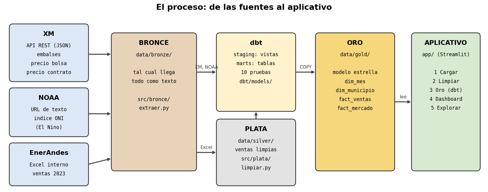
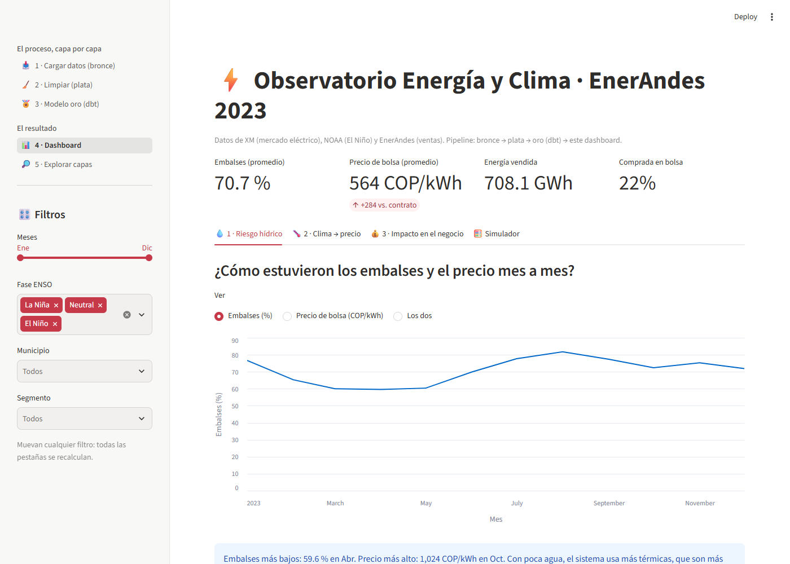
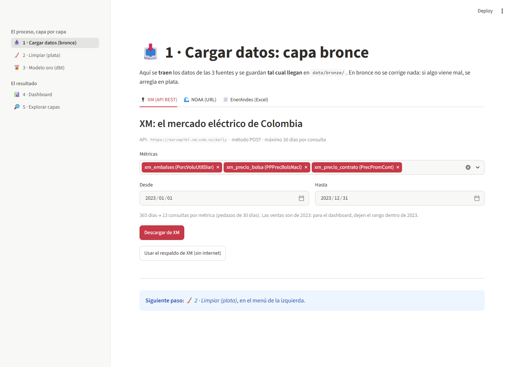
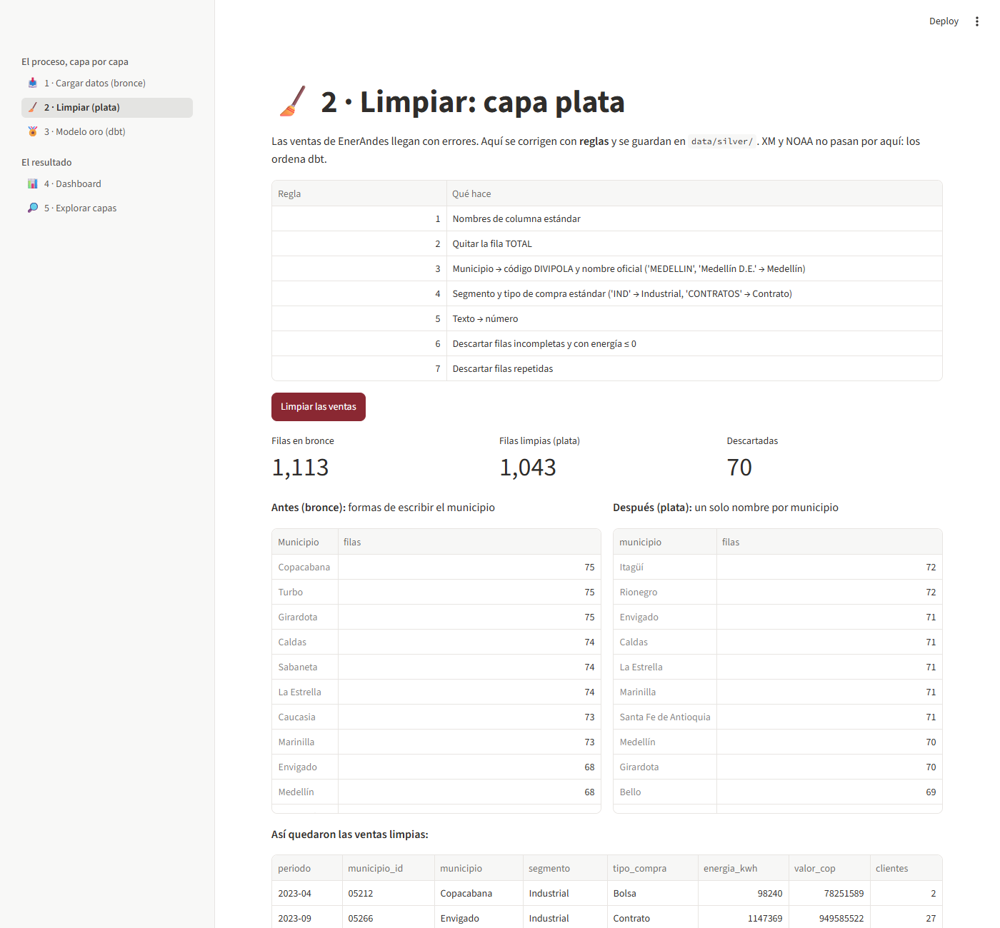
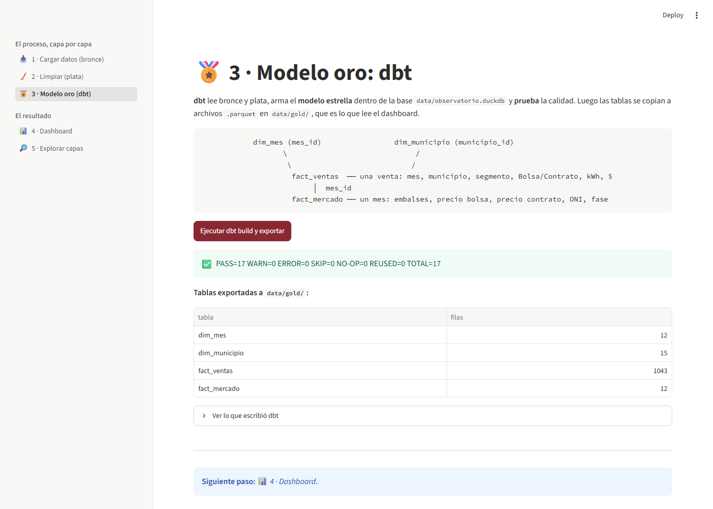
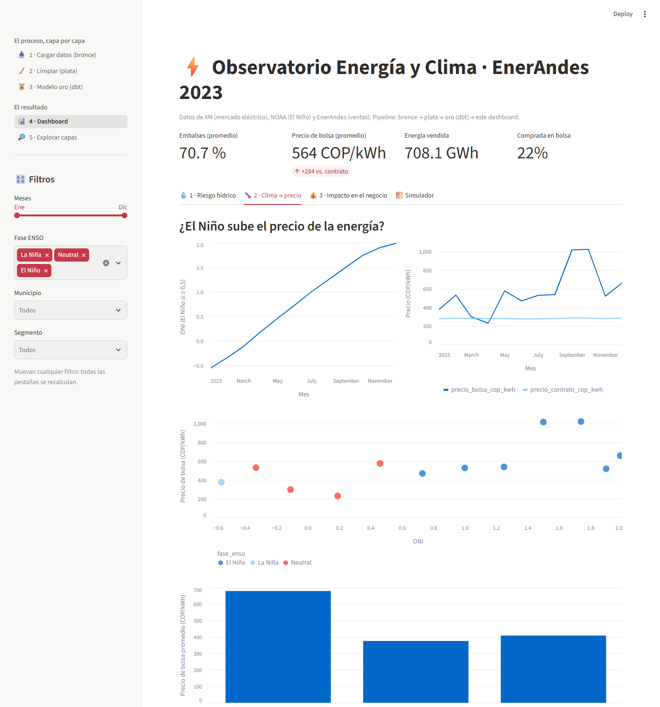
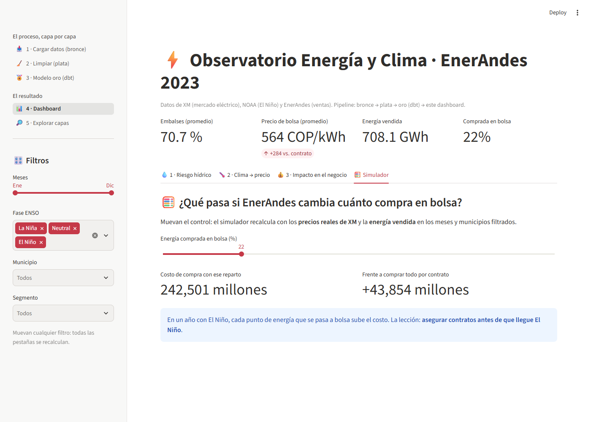
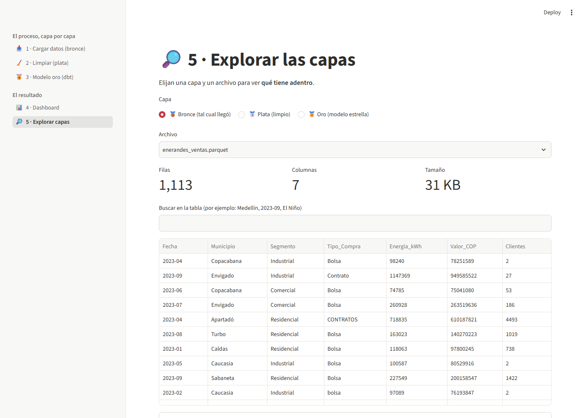

# Observatorio Energía y Clima · versión Docker

Proyecto de curso: **Proyecto Integrado IV – Integración de Información** (IU Digital de Antioquia).

Un aplicativo **completo y funcionando** que muestra el proceso de integración de información de punta a punta: **traer** datos de 3 fuentes, **limpiarlos**, **modelarlos** con dbt y **analizarlos** en un dashboard interactivo. Todo en **Python**, por **capas**, y con **un solo comando**.

> **Para qué sirve.** Es la versión de referencia: se ejecuta, se estudia y luego cada equipo **aplica lo mismo a su proyecto**.



---

## 1. Qué necesita instalado (una sola vez)

| Herramienta | Para qué |
|---|---|
| **Git** | Clonar el repositorio |
| **Docker Desktop** | Corre todo: Python, dbt y Streamlit van **dentro** del contenedor |
| **VS Code** | El editor y su terminal (*Terminal → New Terminal*) |

> No hace falta instalar Python, dbt ni Streamlit en el PC.

---

## 2. Ejecutarlo (un solo comando)

En la terminal de VS Code:

```powershell
git clone https://github.com/ccastro2050/observatorio-energia-docker.git   # bajar el proyecto
cd observatorio-energia-docker                                             # entrar a la carpeta
docker compose up --build                                                  # construir y prender todo
```

| Lo que se ve en la terminal | Qué significa |
|---|---|
| `pipeline-1 | === PIPELINE: bronce -> plata -> oro ===` | El primer contenedor empezó a trabajar |
| `pipeline-1 |    XM PorcVoluUtilDiar: 365 dias` | Bajó los datos de XM (unos 30 a 90 segundos) |
| `pipeline-1 | Done. PASS=17 WARN=0 ERROR=0` | dbt armó el modelo estrella y pasaron las pruebas |
| `pipeline-1 exited with code 0` | El pipeline terminó **bien** y se apagó |
| `app-1 | You can now view your Streamlit app` | El aplicativo está prendido |

Abran **http://localhost:8501**: se abre el **Panel de control**.

> 💡 Con `docker compose up --build -d` la terminal queda libre (`-d` = en segundo plano). Para apagar: `docker compose down`.

---

## 3. El aplicativo: todo sin comandos

Después del `docker compose up`, **todo se hace desde el navegador**: no hay que volver a escribir comandos.

| Página | Capa | Qué se hace |
|---|---|---|
| 🎛️ **0 · Panel de control** (la de inicio) | Todas | Ver el **estado** de cada capa · 🗑️ **Empezar de cero** · ▶️ **Correr todo** o **solo una capa** · **subir otro Excel** de ventas. Al terminar, el **Dashboard se actualiza solo** |
| 📥 **1 · Cargar datos** | Bronce | Elegir métricas y fechas de **XM**, cambiar la **URL** de NOAA, **subir** otro Excel (o descargar el original como plantilla). Botón de respaldo si no hay internet |
| 🧹 **2 · Limpiar** | Plata | Ver las reglas, aplicarlas con un botón y comparar el **antes y el después** |
| 🏅 **3 · Modelo oro** | Oro | Ejecutar **dbt build** con un botón: modelo estrella, **pruebas** y exportación |
| 📊 **4 · Dashboard** | — | Las 3 preguntas de negocio, con **filtros** que mueven todo, y un **simulador** |
| 🔎 **5 · Explorar capas** | — | Abrir cualquier archivo de bronce, plata u oro y **buscar** dentro |



| Lo que aparece | Qué significa |
|---|---|
| Menú de la izquierda | Las 6 páginas: el panel, el proceso capa por capa y el resultado |
| **Filtros** (meses, fase ENSO, municipio, segmento) | Al moverlos, **todo** se recalcula: KPIs, gráficos y conclusiones |
| Los 4 números de arriba | Los **KPIs**: embalses, precio de bolsa (y cuánto más caro que el contrato), energía vendida y % comprado en bolsa |
| Las pestañas | Una por pregunta de negocio, más el **Simulador** |
| El recuadro azul | La **conclusión**, con números calculados por el código |

### Las demás páginas

| Página | Pantalla |
|---|---|
| **1 · Cargar datos**: métricas y fechas de XM, URL de NOAA, subir el Excel |  |
| **2 · Limpiar**: cuántas filas entraron y quedaron, y el municipio antes y después |  |
| **3 · Modelo oro**: el modelo estrella y `PASS=17` |  |
| **4 · Dashboard, pestaña Clima → precio**: ONI, precios, dispersión y precio por fase |  |
| **4 · Dashboard, Simulador**: mover el % comprado en bolsa y ver el costo |  |
| **5 · Explorar capas**: abrir cualquier archivo de bronce, plata u oro |  |

---

## 4. Cómo está organizado

```text
observatorio-energia-docker\
├── README.md                      ← este documento
├── TUTORIAL_PUBLICAR_RENDER.md    ← publicarlo en internet, gratis
├── Dockerfile                     ← la receta de la imagen: Python + librerias + codigo
├── docker-compose.yml             ← los 2 contenedores: pipeline y app
├── iniciar.sh                     ← arranque con UN contenedor (Render): pipeline y luego app
├── requirements.txt               ← las librerias, con version fija
├── src\                           ← EL PROCESO, por capas
│   ├── config.py                  ← fechas, URLs y carpetas: todo lo que puede cambiar
│   ├── utils.py                   ← mensajes, peticiones con reintentos, guardar Parquet
│   ├── pipeline.py                ← las 3 capas en orden: python -m src.pipeline
│   ├── bronce\extraer.py          ← CAPA BRONCE: XM, NOAA y el Excel, tal cual
│   ├── plata\limpiar.py           ← CAPA PLATA: las 7 reglas de limpieza de las ventas
│   └── oro\construir.py           ← CAPA ORO: dbt build y exportar a Parquet
├── dbt\                           ← EL MODELO
│   ├── dbt_project.yml            ← staging = vistas, marts = tablas
│   ├── profiles.yml               ← la conexion: data/observatorio.duckdb
│   └── models\
│       ├── staging\               ← ordenar lo que llega (texto -> numero, por dia o mes)
│       └── marts\                 ← el modelo estrella (2 dimensiones, 2 hechos) y sus 10 pruebas
├── app\                           ← EL APLICATIVO (Streamlit)
│   ├── inicio.py                  ← el menu de las 6 paginas: streamlit run app/inicio.py
│   ├── datos.py                   ← la COCINA: lee el oro y calcula (sin Streamlit)
│   └── paginas\                   ← el COMEDOR: panel, cargar, limpiar, oro, dashboard, explorar
├── tests\test_proceso.py          ← 5 pruebas: limpieza, calculos y Excel subido (pytest)
├── data\
│   ├── insumos\                   ← el Excel de ventas de EnerAndes (se sube a Git)
│   ├── ejemplo\                   ← respaldo de XM y NOAA, por si no hay internet (se sube a Git)
│   ├── bronze\  silver\  gold\    ← las 3 capas: las GENERA el pipeline (no se suben a Git)
│   └── observatorio.duckdb        ← la base donde dbt arma el oro (no se sube a Git)
└── docs\
    ├── dominio\                   ← EL NEGOCIO: problema, fuentes, modelo de datos, arquitectura
    ├── conceptos\                 ← LOS CONCEPTOS: capas, pipeline, modelo estrella, dbt, Docker, Streamlit
    └── img\                       ← diagramas y pantallas
```

---

## 5. La documentación

| Carpeta | Documento | Qué explica |
|---|---|---|
| `docs/dominio/` | [NEGOCIO.md](docs/dominio/NEGOCIO.md) | EnerAndes, el problema y las 3 preguntas |
| | [FUENTES.md](docs/dominio/FUENTES.md) | XM, NOAA y el Excel: cómo se piden y qué traen |
| | [MODELO_DE_DATOS.md](docs/dominio/MODELO_DE_DATOS.md) | Las 4 tablas de oro, sus llaves y sus pruebas |
| | [ARQUITECTURA.md](docs/dominio/ARQUITECTURA.md) | Las capas, la cocina y el comedor, los contenedores |
| `docs/conceptos/` | [CAPAS_MEDALLON.md](docs/conceptos/CAPAS_MEDALLON.md) | Bronce, plata y oro |
| | [PIPELINE.md](docs/conceptos/PIPELINE.md) | Extraer, transformar, cargar; reintentos y respaldo |
| | [MODELO_ESTRELLA.md](docs/conceptos/MODELO_ESTRELLA.md) | Hechos, dimensiones y llaves |
| | [DBT.md](docs/conceptos/DBT.md) | Modelos, `source`, `ref`, pruebas y DuckDB |
| | [DOCKER.md](docs/conceptos/DOCKER.md) | Imagen, contenedor, volumen y los comandos |
| | [STREAMLIT.md](docs/conceptos/STREAMLIT.md) | Cómo funciona y cada función que usa el proyecto |
| | [GLOSARIO.md](docs/conceptos/GLOSARIO.md) | Los términos, en una tabla |

---

## 6. Comandos útiles

| Comando | Qué hace |
|---|---|
| `docker compose up --build` | Construir y prender todo |
| `docker compose up --build -d` | Lo mismo, sin ocupar la terminal |
| `docker compose logs pipeline` | Ver lo que hizo el pipeline |
| `docker compose run --rm pipeline` | Volver a correr **solo** el pipeline |
| `docker compose down` | Apagar todo (los datos de `data/` se quedan) |
| `docker compose run --rm app pytest -v` | Correr las 5 pruebas dentro del contenedor |

---

## 7. Si algo falla

| Si sale | Por qué | Qué hacer |
|---|---|---|
| `port is already allocated` (8501) | Otro programa usa el puerto 8501 (otro Streamlit, otro contenedor) | `docker ps` para ver cuál, y apagarlo; o en `docker-compose.yml` cambiar `"8501:8501"` por `"8502:8501"` y abrir `localhost:8502` |
| `! XM no respondio (...). Se usa el respaldo.` | Sin internet o XM caído | Nada: usa `data/ejemplo/` y sigue |
| `pipeline-1 exited with code 1` y el app no arranca | Falló una capa (por ejemplo, una prueba de dbt) | `docker compose logs pipeline` y leer el error |
| `Cannot connect to the Docker daemon` | Docker Desktop está apagado | Abrir Docker Desktop y esperar a que diga *Engine running* |
| La página dice *"Todavía no hay capa oro"* | El pipeline no ha terminado o falló | Esperar, o correr las páginas 1, 2 y 3 |

---

## 8. Publicarlo en internet

Ver [TUTORIAL_PUBLICAR_RENDER.md](TUTORIAL_PUBLICAR_RENDER.md): gratis, con el mismo `Dockerfile`.

---

## 9. De esta versión a su proyecto

| Aquí | En su proyecto |
|---|---|
| 3 fuentes: XM, NOAA y un Excel | Sus fuentes (por lo menos una API y un archivo) |
| `src/config.py` | Sus fechas, URLs y métricas |
| 7 reglas en `src/plata/limpiar.py` | Las reglas que necesiten **sus** datos |
| 4 tablas en `dbt/models/marts/` | Su modelo estrella, con sus pruebas |
| 3 preguntas en el dashboard | Sus preguntas de negocio, cada una con su conclusión |
