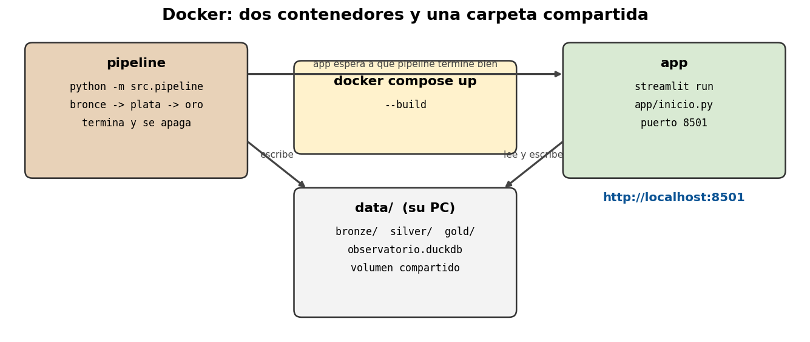

# Docker

> **En una frase:** Docker empaca el proyecto **con todo lo que necesita** (Python, dbt, librerías) para que corra **igual en cualquier computador**.

| Concepto | Qué es | En este proyecto |
|---|---|---|
| **Imagen** | La "receta" ya cocinada: Linux + Python + librerías + código | Se construye con el `Dockerfile` |
| **Contenedor** | Una imagen **corriendo** | `pipeline` y `app` |
| **`Dockerfile`** | Los pasos para armar la imagen | `FROM python:3.13-slim` → `pip install` → `COPY` |
| **`docker-compose.yml`** | Varios contenedores que se prenden juntos | `pipeline` + `app` |
| **Volumen** | Una carpeta **compartida** entre el contenedor y su PC | `./data:/app/data` |
| **Puerto** | La "puerta" por la que se entra al contenedor | `8501:8501` |
| **`depends_on`** | Esperar a que otro contenedor termine | `app` espera a que `pipeline` termine bien |

## Los comandos

| Comando | Qué hace |
|---|---|
| `docker compose up --build` | Construye la imagen y prende los dos contenedores |
| `docker compose up --build -d` | Lo mismo, pero devuelve la terminal (`-d` = en segundo plano) |
| `docker compose logs pipeline` | Ver lo que escribió el pipeline |
| `docker compose run --rm pipeline` | Correr **otra vez** solo el pipeline |
| `docker compose down` | Apagar y quitar los contenedores (los datos de `data/` se quedan) |
| `docker ps` | Ver qué contenedores están prendidos |

## ¿Por qué no instalar Python y ya?

| Sin Docker | Con Docker |
|---|---|
| Cada quien instala su versión de Python y de dbt: "en mi PC sí funciona" | Todos corren **la misma imagen** |
| dbt, DuckDB y Streamlit a mano | Un solo comando |
| Para publicar en internet hay que reinstalar todo | Render corre el **mismo `Dockerfile`** |
