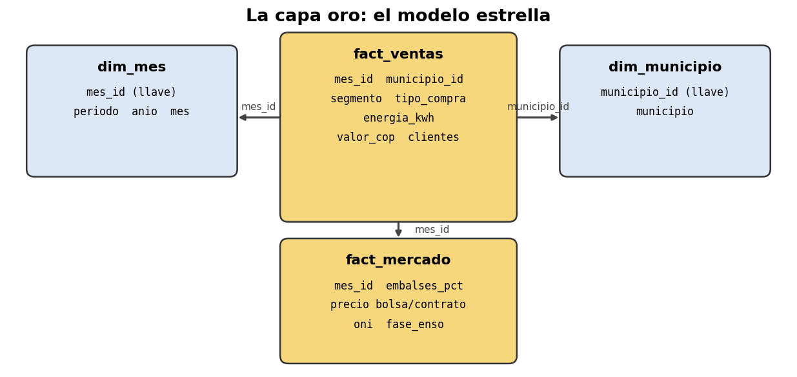

# El modelo estrella

> **En una frase:** una tabla de **hechos** en el centro (lo que pasó, con números) rodeada de tablas de **dimensiones** (el contexto: cuándo, dónde, quién).



| Tipo | Qué guarda | Ejemplo |
|---|---|---|
| **Hechos** (*fact*) | Los **eventos** y sus **medidas**: los números que se suman o promedian | `fact_ventas`: cada venta con sus kWh y sus pesos |
| **Dimensión** (*dim*) | Las **descripciones**: los nombres para filtrar y agrupar | `dim_municipio`: `05001` → `Medellín` |
| **Llave** | La columna que une un hecho con su dimensión | `municipio_id` |
| **Grano** | Qué es **una fila** de la tabla de hechos | Un mes + un municipio + un segmento + un tipo de compra |

## ¿Por qué así y no una sola tabla gigante?

- El nombre `Medellín` se escribe **una vez** (en la dimensión), no en mil ventas.
- Agrupar es fácil: "ventas **por municipio**" = unir con la dimensión y agrupar.
- Es la forma que entienden **Power BI**, **Streamlit**, Tableau y cualquier herramienta de análisis.

## En el código

```python
# app/datos.py: unir el hecho con su dimension (un JOIN)
cargar("fact_ventas").merge(cargar("dim_municipio"), on="municipio_id")
```

`on="municipio_id"` dice **por cuál columna emparejar**: la venta con `05001` recibe el nombre `Medellín`.
