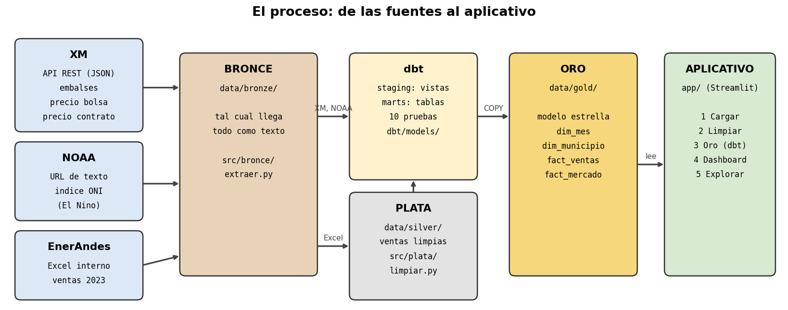
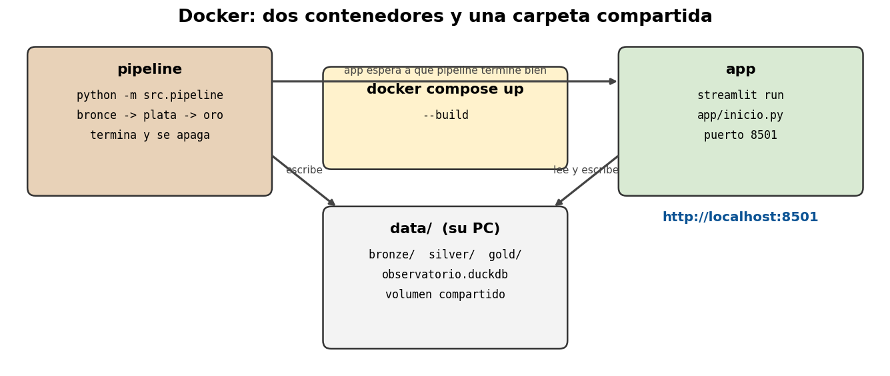

# La arquitectura: capas y contenedores

> **Qué es este documento.** Cómo está partido el proyecto y qué hace cada parte.
> **Los conceptos detrás:** [CAPAS_MEDALLON.md](../conceptos/CAPAS_MEDALLON.md) y [DOCKER.md](../conceptos/DOCKER.md)

## 1. Las capas del dato

| Capa | Carpeta de datos | Código | Qué hace | Lo que tiene prohibido |
|---|---|---|---|---|
| **Bronce** | `data/bronze/` | `src/bronce/extraer.py` | Trae los datos tal cual | **Corregir** nada |
| **Plata** | `data/silver/` | `src/plata/limpiar.py` | Limpia las ventas con reglas | Calcular indicadores del negocio |
| **Oro** | `data/gold/` | `dbt/models/` + `src/oro/construir.py` | Modelo estrella + pruebas | Leer de las APIs |
| **Aplicativo** | — | `app/` | Muestra, filtra y simula | Leer bronce o plata para el dashboard: **solo lee oro** |

> **La regla que no se negocia:** el dashboard **solo lee `data/gold/`**. Si leyera bronce, mostraría datos sin limpiar ni probar.

## 2. La cocina y el comedor (el aplicativo)

| Archivo | Papel | Por qué separado |
|---|---|---|
| `app/datos.py` | La **cocina**: lee el oro y calcula (pandas) | Se prueba con `pytest` sin abrir la página |
| `app/paginas/*.py` | El **comedor**: lo que se ve (Streamlit) | Solo dibuja: los cálculos los pide a la cocina |

## 3. Los contenedores

| Contenedor | Comando | Vida |
|---|---|---|
| `pipeline` | `python -m src.pipeline` | Corre una vez y se apaga |
| `app` | `streamlit run app/inicio.py` | Se queda prendido en el puerto **8501** |

Comparten la carpeta **`data/`** (un *volumen*): lo que escribe uno lo lee el otro, y usted lo ve en su PC.

En **Render** hay un solo contenedor: `iniciar.sh` corre el pipeline y luego el aplicativo. Ver [TUTORIAL_PUBLICAR_RENDER.md](../../TUTORIAL_PUBLICAR_RENDER.md).
