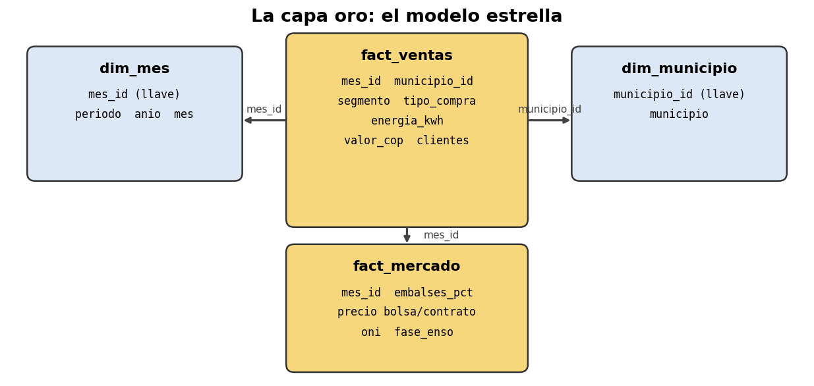

# El modelo de datos: la capa oro

> **Qué es este documento.** Las tablas que lee el dashboard y cómo se unen.
> **El concepto detrás:** [MODELO_ESTRELLA.md](../conceptos/MODELO_ESTRELLA.md)

## Las 4 tablas

| Tabla | Tipo | Una fila es... | Columnas |
|---|---|---|---|
| `dim_mes` | Dimensión | un mes de 2023 | `mes_id` (202304), `periodo` ('2023-04'), `anio`, `mes` |
| `dim_municipio` | Dimensión | un municipio | `municipio_id` (DIVIPOLA '05001'), `municipio` |
| `fact_ventas` | Hechos | una venta: mes + municipio + segmento + tipo de compra | `mes_id`, `municipio_id`, `segmento`, `tipo_compra`, `energia_kwh`, `valor_cop`, `clientes` |
| `fact_mercado` | Hechos | un mes del mercado | `mes_id`, `mes`, `embalses_pct`, `precio_bolsa_cop_kwh`, `precio_contrato_cop_kwh`, `oni`, `fase_enso` |

## Las llaves

| Llave | Une | Para qué |
|---|---|---|
| `mes_id` | `fact_ventas` ↔ `dim_mes` ↔ `fact_mercado` | A cada venta se le trae **el precio de su mes** (pregunta 3) |
| `municipio_id` | `fact_ventas` ↔ `dim_municipio` | A cada venta se le trae **el nombre** del municipio |

## Las pruebas de calidad (dbt)

| Prueba | Tabla y columna | Qué garantiza |
|---|---|---|
| `unique` + `not_null` | `dim_mes.mes_id`, `dim_municipio.municipio_id`, `fact_mercado.mes_id` | La llave no se repite ni está vacía |
| `relationships` | `fact_ventas.mes_id` y `municipio_id` | Cada venta apunta a un mes y un municipio que existen |
| `accepted_values` | `fact_ventas.tipo_compra` | Solo `Bolsa` o `Contrato` |
| `not_null` | `fact_mercado.precio_bolsa_cop_kwh` | Todos los meses tienen precio |

**10 pruebas.** Si una falla, `dbt build` se detiene y **no llegan datos malos al dashboard**.

Siguiente: [ARQUITECTURA.md](ARQUITECTURA.md)
